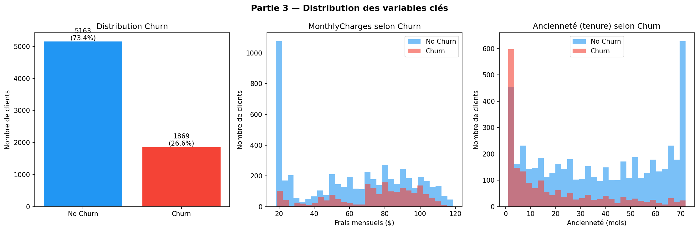
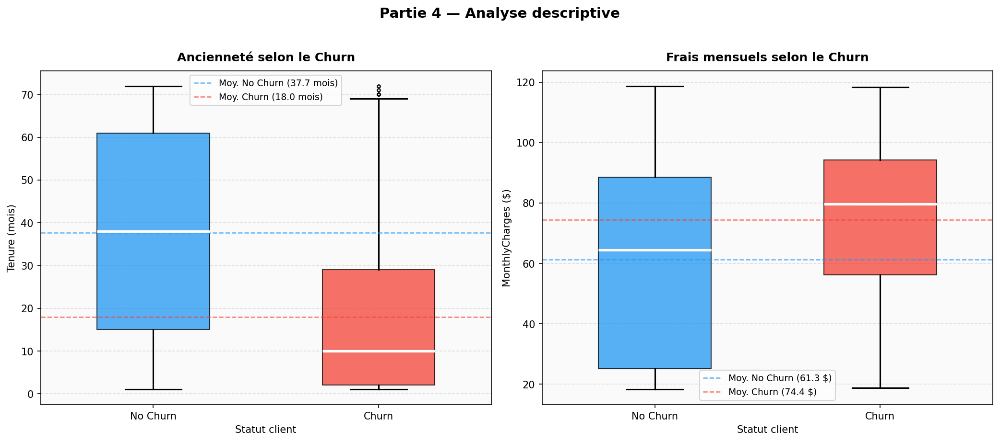
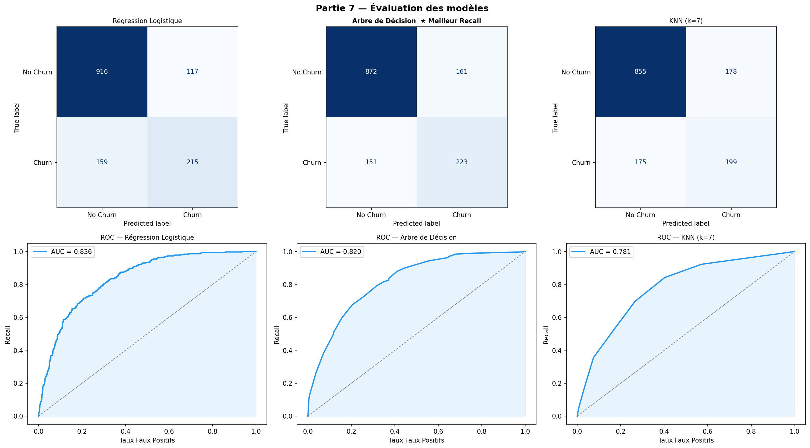
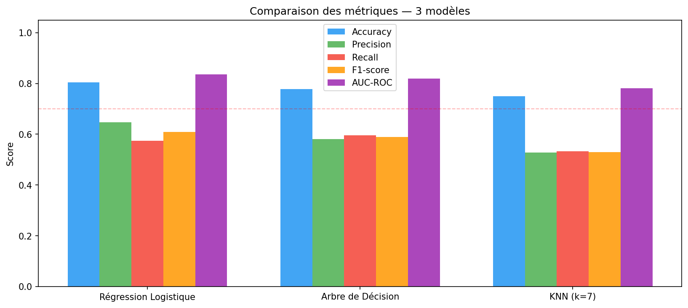
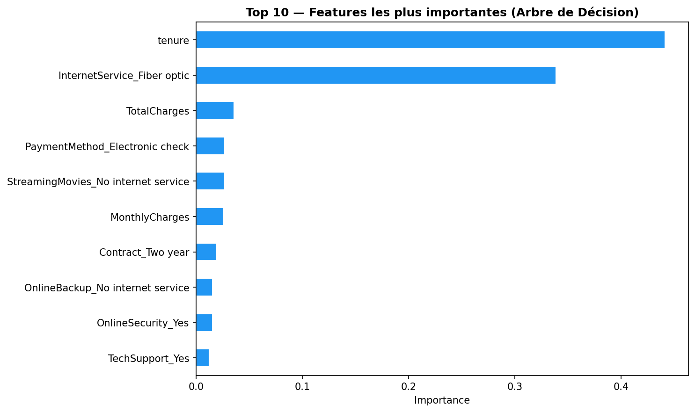

# Telco Customer Churn Prediction

> Workshop 05 · Master MD3SI · Advanced Python (M113) · Université Sultan Moulay Slimane, FP Beni Mellal

## Overview

This end-to-end Python project predicts which telecom customers are likely to leave (churn). It covers data exploration, cleaning, descriptive analysis, three classification models and an evaluation focused on business needs. The best model is chosen automatically by recall on the churn class.

## Problem / Goal

Losing customers is expensive for telecom operators. The goal is to spot likely churners early so retention teams can act. Missing a churner costs more than contacting a loyal customer, so **recall** is the main metric, with F1 and AUC-ROC as secondary metrics.

## Dataset

[Telco Customer Churn (IBM sample, Kaggle)](https://www.kaggle.com/datasets/blastchar/telco-customer-churn), file `WA_Fn-UseC_-Telco-Customer-Churn.csv`:
- 7,043 customers and 21 columns; 7,032 remain after removing rows with an empty `TotalCharges`.
- Target: `Churn` (Yes / No).
- Imbalanced classes: about 73.4% No and 26.6% Yes.

## Approach & techniques

| Step | What the script does |
|---|---|
| Exploration | Shape, data types and missing values |
| Cleaning | Converts `TotalCharges` to a number and drops invalid rows. Encodes categories with `LabelEncoder` for binary columns and `get_dummies` for the rest. |
| Descriptive analysis | Distributions, churn rate, tenure and monthly charges for churners vs. non-churners |
| Modelling | Stratified 80/20 split and `StandardScaler`. Three models: `LogisticRegression`, `DecisionTreeClassifier(max_depth=5)` and `KNeighborsClassifier(k=7)` |
| Evaluation | Accuracy, precision, recall, F1, AUC-ROC, confusion matrices and ROC curves |
| Interpretation | Top-10 feature importances from the decision tree, plus retention recommendations |

## How to run

```bash
git clone https://github.com/oukim/churn-prediction.git
cd churn-prediction
pip install pandas numpy matplotlib seaborn scikit-learn
python Atelier.py
```

The dataset CSV is already in the repo. The script prints its analysis to the console and saves the charts as `P3_…` to `P8_…` PNG files.

## Results

These are test-set results (1,407 customers) from running `Atelier.py`:

| Model | Accuracy | Precision | Recall (churn) | F1 | AUC-ROC |
|---|:-:|:-:|:-:|:-:|:-:|
| Logistic Regression | **0.804** | **0.648** | 0.575 | **0.609** | **0.836** |
| **Decision Tree, max_depth=5 (selected by recall)** | 0.778 | 0.581 | **0.596** | 0.588 | 0.820 |
| KNN, k=7 | 0.749 | 0.528 | 0.532 | 0.530 | 0.781 |

- The decision tree has the best recall. Logistic regression is best on accuracy, precision, F1 and AUC-ROC.
- The most important features in the decision tree are `tenure` and `InternetService_Fiber optic`, followed by `TotalCharges`.
- In the data, churners have an average tenure of about 18 months, against about 38 months for customers who stay. They also pay more per month on average.
- **Possible next step (not implemented):** class rebalancing such as SMOTE, tree ensembles and decision-threshold tuning to raise recall.

### Visualisations

| | |
|---|---|
|  |  |
|  |  |



## Tech stack

Python · pandas · NumPy · scikit-learn · matplotlib · seaborn

## Author

Aboubaker Oukim · [LinkedIn](https://ma.linkedin.com/in/aboubaker-oukim-2a052b22b)
